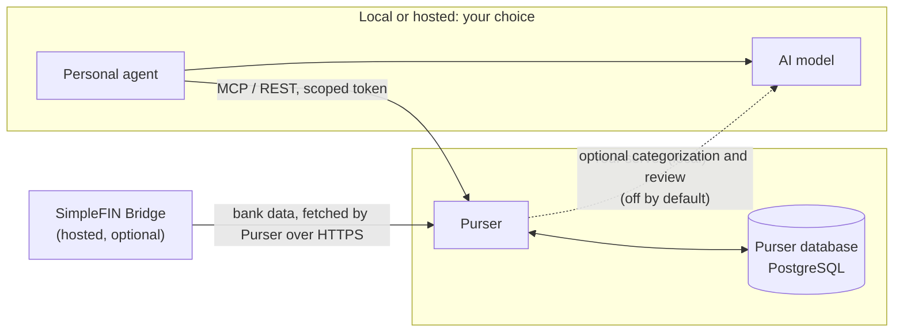
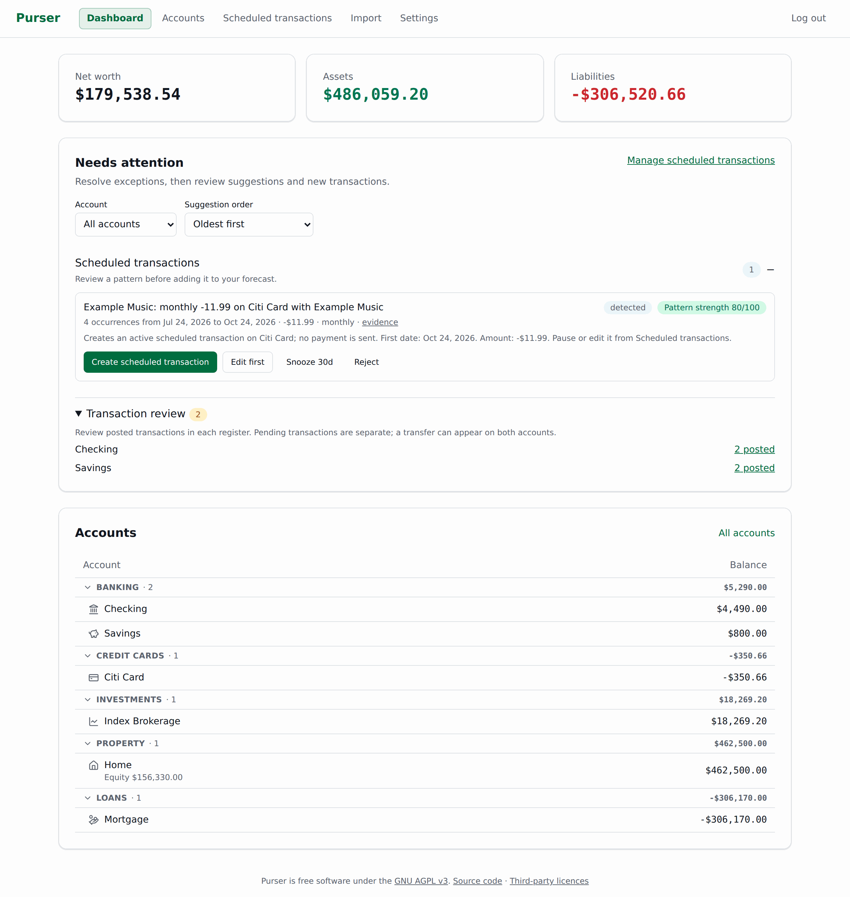
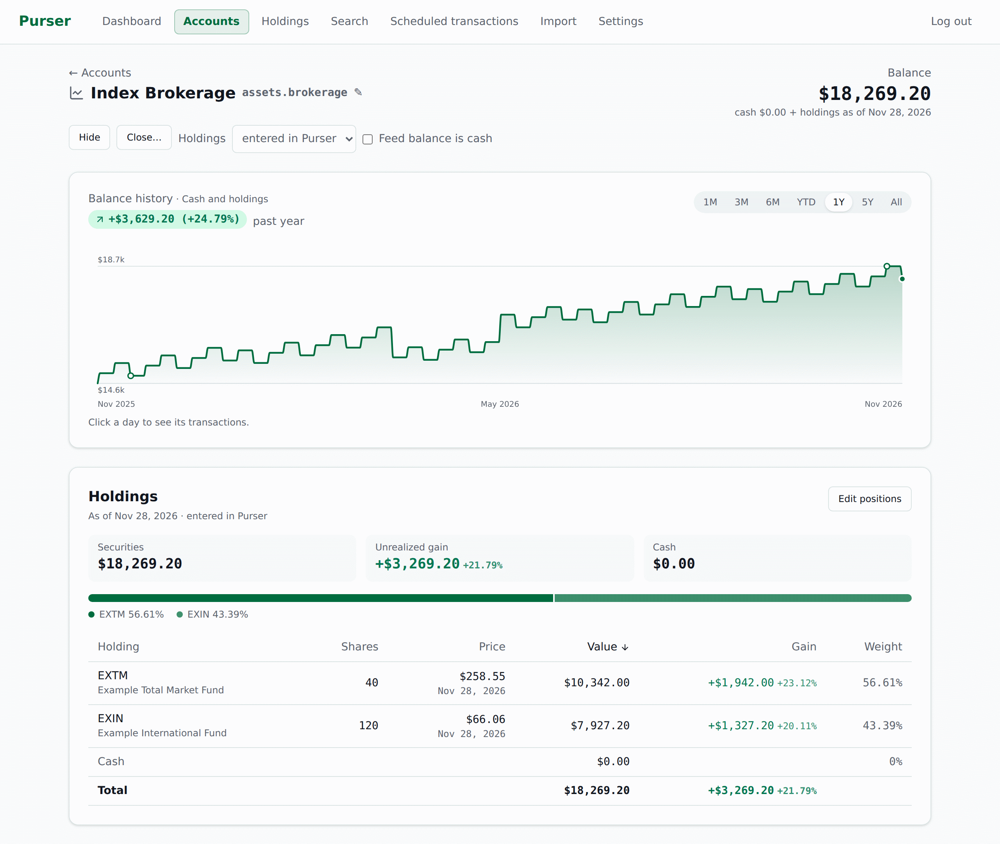
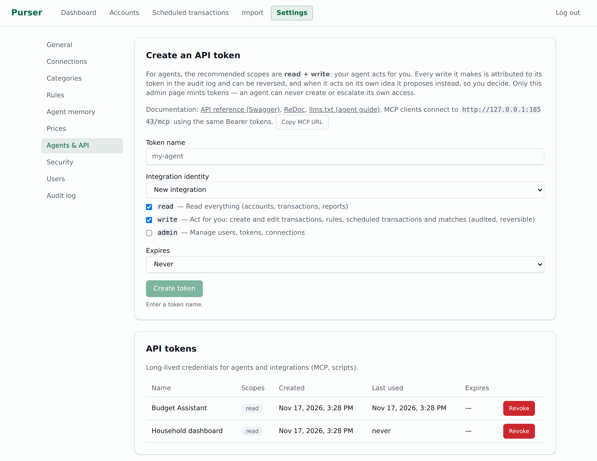

# Purser

**The privately hosted finance back-end, designed for use by your personal AI Agent.**

Purser syncs bank accounts, categorizes transactions, tracks bills, reconciles
statements, forecasts cash flow and values investments. It is mostly headless:
you work through your own AI agent over MCP or REST. A web UI provides the
administrative controls for setup, configuration, access and record inspection.

Purser is not an AI. It is an AI enablement engine: it stores financial data,
performs calculations and provides tools for your agent to use. Purser requires
no AI subscription. Optional integrations can call a model you configure for
categorization and review; they are off by default.

You choose what to share with your agent. Purser provides access scopes,
disclosure settings and an audit log; it does not prescribe how much financial
information you should share.

**Documentation:** https://mlamoure.github.io/purser/

## Hosting and access

- **Privately hosted.** Purser runs on your own hardware with Docker. Bank
  data is stored on your server, with sensitive fields encrypted at rest.
  There is no Purser cloud account.
- **Scoped access.** Give an agent read access or read and write access.
  Token creation and configuration require a separate admin scope.
- **Privacy on request.** Your agent can ask Purser to leave payee names,
  descriptions and individual amounts out of any answer that doesn't need
  them, over MCP or the REST API; see [Privacy: your agent asks only for what
  it needs](#privacy-your-agent-asks-only-for-what-it-needs).
- **Server-side calculations.** Tools return totals, balances, net worth and
  forecasts without requiring the agent to read every transaction. An agent
  can also link to records for you to inspect in Purser.
- **Auditing.** The Data shared view identifies integrations, returned field
  inventories, coverage, omissions and outcomes, with filters and exports.
  Every call says whether the agent used privacy or the answer returned
  identifiable payees, descriptions or amounts.
  Older entries and incomplete evidence are labeled explicitly. Integration
  responses are recorded before release; a capture error withholds the response,
  although a requested write may already have completed. Posted transactions
  are corrected through linked reversal and replacement entries.



Purser and its database run on your server. Your agent reaches Purser with a
scoped token and uses whichever model you choose; Purser itself calls a model
only if you configure one.

## Privacy: your agent asks only for what it needs

What your agent reads into its conversation may reach its model provider. So
on any call, over MCP or the REST API, your agent can ask Purser to leave out
the payee names, descriptions or individual amounts that the question doesn't
need. Purser removes them before the answer leaves your server and says what
it removed.

- *"How many times did we eat out this month?"* The agent asks for the dining
  rows with `withhold: ["payee", "description", "amount"]` and counts them.
  Payees arrive as stable references such as `py_8k2mq4x7ra`, which the agent
  can still filter and act with, and the answer lists what was left out.
- *"Who did we pay most at restaurants?"* That needs payee names, so the agent
  asks without `withhold` and gets them.
- Totals and balances always stay exact. To show you the rows themselves, the
  agent sends a link that opens them in Purser, so the details reach you
  without passing through the model.

Nothing is withheld unless the agent asks: the choice is the agent's, call by
call, because most financial questions need some detail. It is a privacy aid,
not an access control (token scopes decide what an agent can read). The audit
log marks every call **Privacy used** or **Identifiable** and can filter on
either, so you can see when your financial details were shared.


How it works in detail, with examples:
[Privacy and agents](https://mlamoure.github.io/purser/explanation/privacy-and-agents/).

## What you can ask your agent

- *"How much did we spend on groceries last month, compared with the month before?"*
- *"What's our net worth, and how has it changed this year?"*
- *"Will checking stay above $500 until the end of the month?"*
- *"Which bills haven't come in yet?"*
- *"Here's my card statement email. Set the payment to the statement balance."*
- *"Anything new or unusual since yesterday?"*

## Features

### Accounts and imports

- **Bank sync** through [SimpleFIN Bridge](https://bridge.simplefin.org/) for checking, savings, credit cards and brokerage accounts.
- **QIF and CSV imports** with a preview and duplicate detection.
- **Investments:** holdings from your brokerage feed or tracked by hand, priced daily and included in net worth.
- **Tax lots and equity awards** for holdings you track by hand: load a broker's lot list and vest schedule in one previewed step. Sales name the lots they draw on. Home includes potential value inside the Net worth and Assets cards when unvested awards exist; users without them see only current owned totals. Unvested awards remain outside owned net worth until vesting.

### Ledger and reconciliation

- **Balanced entries.** Transaction postings sum to zero per currency. Corrections to posted transactions preserve the original entry and its history.
- **Source records.** Original bank payloads are retained for tracing imported transactions.
- **Reconciliation** against account statements, including explicit cash-only reconciliation for manually tracked brokerage accounts.
- **Transfers** between your own accounts are linked and excluded from spending totals.

### Bills and forecasts

- **Recurring bills and income** are detected or entered as schedules, then matched to incoming transactions.
- **Occurrence estimates:** amount and date uncertainty are tracked separately, with evidence, original estimates and linked actuals. Fixed planning values can remain estimates, including projected slots without transaction IDs, without changing forecast amounts or dates. Confirm one payment without confirming later ones; ambiguous matches wait for review.
- **Late bills and price changes** are flagged.
- **Cash-flow forecasts** use schedules to project account balances and flag balances below your chosen floor.

### Categories, rules and notes

- **Categories** come with a default hierarchy you can edit.
- **Rules** categorize transactions and rename payees. Draft rules take effect when activated.
- **Review and suggestions inboxes** collect new transactions, proposed schedules, transfer links and matches.
- **[Financial notes](https://mlamoure.github.io/purser/explanation/memories/)** keep context about your finances in one place, such as "the HOA bill is annual," for your agent to use.

## The admin interface

Day-to-day work happens through your AI agent. The web UI provides the
administrative controls for setup, connections, settings, tokens and auditing.
It also lets you inspect accounts and records directly. These screenshots use
synthetic demonstration data.



**Needs attention:** review missing expected payments first, expand suggestions
by type, and open the exact account register for posted or pending review.
**Accounts** are grouped by kind (Banking, Credit cards, Investments, Property,
Loans), each group with its subtotal, on the Dashboard and on the Accounts page.



**Accounts over time:** each account page opens with a chart of its balance,
including holdings for brokerage accounts and valuations for loans. A
brokerage account also lists its holdings, with unrealized gains, each
holding's share of the account, and the cash.

| | |
|---|---|
|  **Access:** create scoped agent tokens under Settings, Agents & API |  **Record inspection:** view transactions, balances and transfer links |


**Scheduled transactions:** the bills, paychecks and transfers behind the
forecast, by payee and memo, with the projected balance for each account.

The interface follows your system's light or dark appearance.

## Get started

Purser runs with Docker on Linux (amd64 or arm64) and on Macs with Apple
Silicon. You use it on that machine or from other machines on your home
network. To have your agent install it, give it this instruction:

```text
Set up Purser for me by following https://mlamoure.github.io/purser/tutorials/ai-setup/
```

The agent does the installing. You create the admin account, store your
encryption key, connect your bank and create the agent's access token in
Purser's setup page, which shows the steps for your client (Claude Code,
Claude Desktop, Codex, Gemini, OpenClaw and others). On a Mac without Docker,
the guide's script installs it first; on Linux, install Docker beforehand.

For manual installation, follow the [Quickstart](https://mlamoure.github.io/purser/tutorials/quickstart/).
Agents that load skills can also use [`skills/purser/SKILL.md`](skills/purser/SKILL.md).

## Reference

- [REST API](https://mlamoure.github.io/purser/reference/rest-api/)
- [MCP tools](https://mlamoure.github.io/purser/reference/mcp-tools/)
- [Connect an agent](https://mlamoure.github.io/purser/how-to/connect-an-agent/)
- [Privacy and agents](https://mlamoure.github.io/purser/explanation/privacy-and-agents/)
- [Ledger](https://mlamoure.github.io/purser/explanation/ledger/)
- [Security model](https://mlamoure.github.io/purser/explanation/security/)
- [Encryption at rest](https://mlamoure.github.io/purser/explanation/encryption-at-rest/)
- [Run with Docker Compose](https://mlamoure.github.io/purser/how-to/docker-compose/)
- [Put Purser behind a reverse proxy](https://mlamoure.github.io/purser/how-to/reverse-proxy/)
- [Backup and restore](https://mlamoure.github.io/purser/how-to/backup-restore/)

## Bugs, ideas and security

Report bugs and ideas in [GitHub Issues](https://github.com/mlamoure/purser/issues).
Report security problems privately through **Report a vulnerability** on the
[Security tab](https://github.com/mlamoure/purser/security). Pull requests are
welcome; the maintainer applies accepted changes upstream.

## License

[AGPL-3.0-only](LICENSE). Third-party components and their licences are
listed in [THIRD_PARTY_NOTICES.md](THIRD_PARTY_NOTICES.md).

## Release security checks

Release qualification audits the locked Python runtime dependencies and scans
native amd64 and arm64 container images. The publication job scans the exact
digest again before creating the release tag. High and critical findings block
publication unless an unfixed finding has a reviewed, package-version-specific
exception in `.trivyignore.yaml`; exceptions expire and never hide an available
fix. Full scan reports remain available as workflow artifacts.

To reproduce locally on Linux, run `bash scripts/audit_python.sh` and
`bash scripts/scan_image.sh <image>`. Both write to `security-reports/`.
