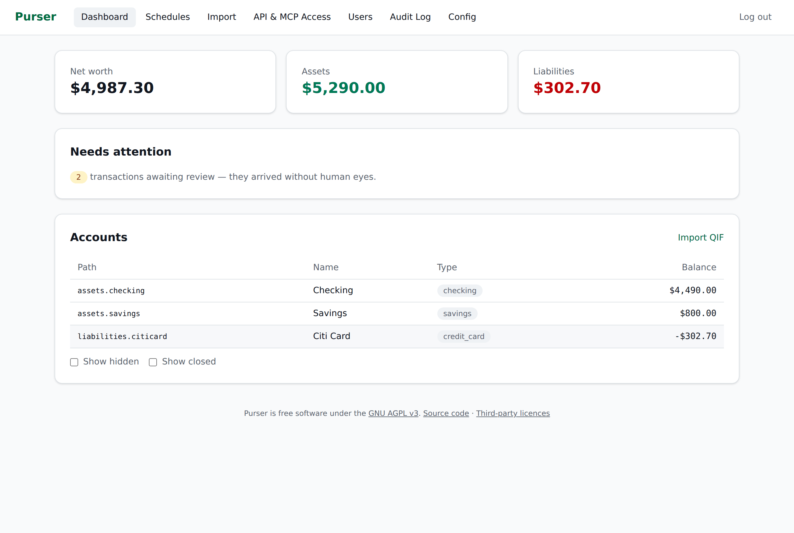
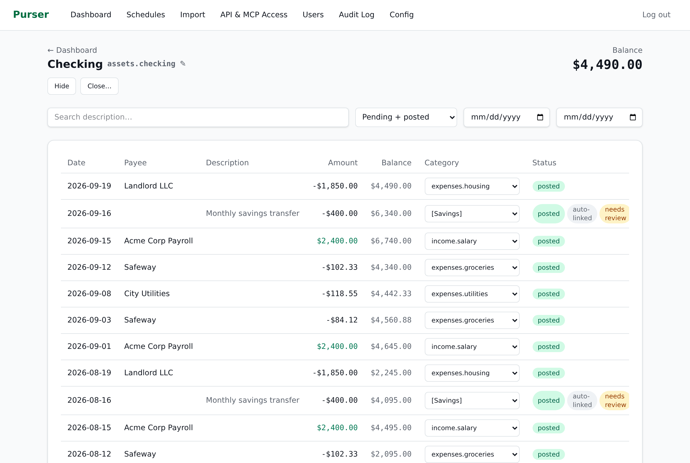
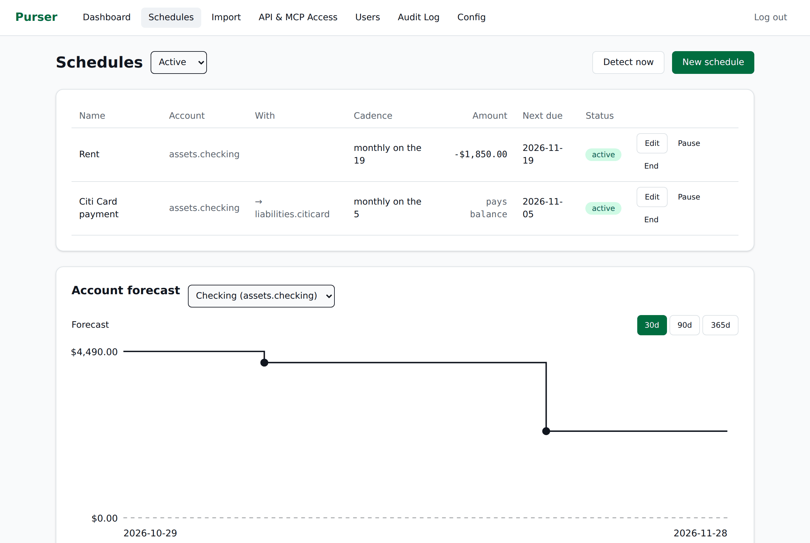
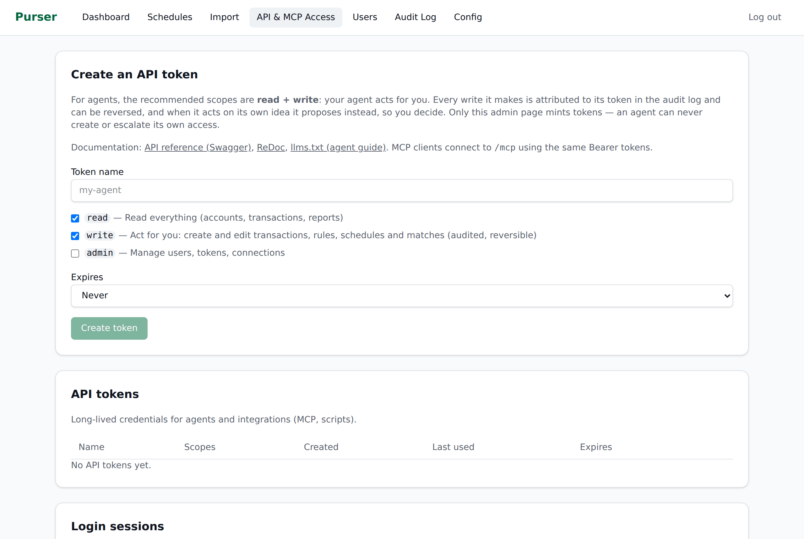
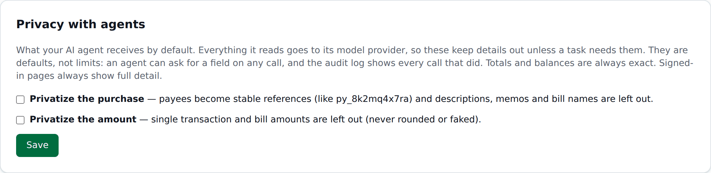
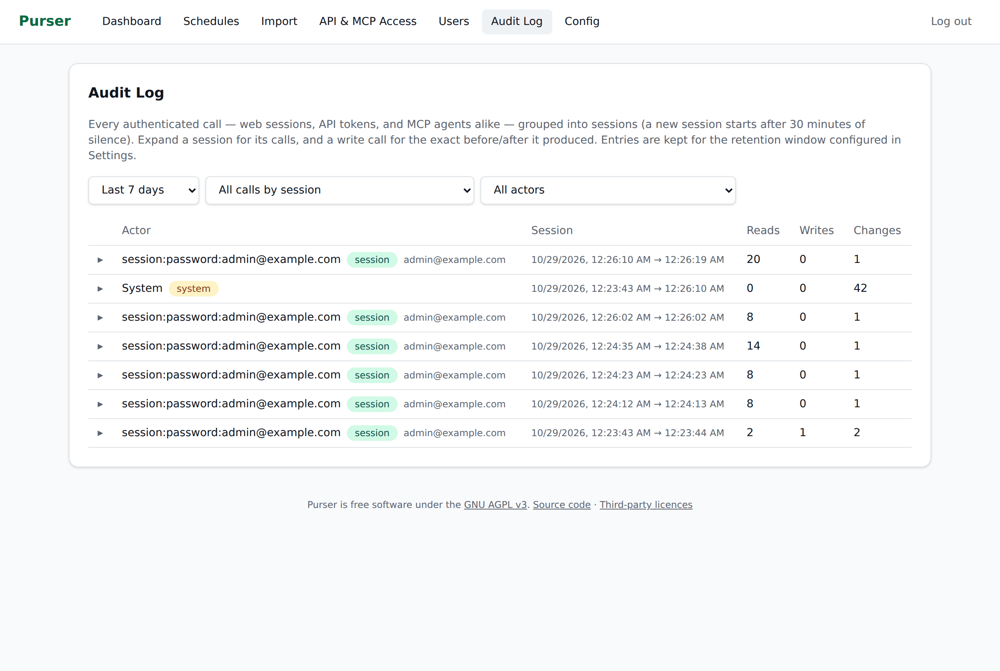

# Purser

**The engine of Quicken, with your AI as the front end.**

Purser is a headless personal-finance engine. It does the work a desktop
finance app does: syncing your bank accounts, categorizing transactions,
tracking bills, reconciling statements, forecasting cash flow and valuing
investments. But it has no app for you to click through. You talk to your
own AI agent (Claude, Codex, an OpenClaw agent or any other MCP client), and
the agent works with Purser through purpose-built tools.

Your financial data stays on your own hardware, and you decide how little of
it your AI ever sees.

📖 **Documentation:** https://mlamoure.github.io/purser/

## Why Purser

- **Headless by design.** There's no front end to learn. Your AI is the
  interface; Purser is the engine underneath. A small web UI covers setup and
  administration.
- **Your data stays local.** Purser runs on your own machine with Docker. Bank
  data comes straight to your server and is encrypted at rest. There's no
  Purser cloud and no account to create.
- **Share as little as possible with AI.** Anything your agent reads goes to
  its model provider, so Purser keeps that to a minimum:
  - **Exact answers without the raw rows.** Totals, balances, net worth and
    forecasts are computed on your server, so your agent can answer "how much
    did we spend on dining?" without reading every transaction.
  - **Privacy switches.** Optionally replace payee names with stable references
    (`py_8k2mq4x7ra`) and withhold individual amounts. Totals stay exact.
  - **Show it to you, not to the AI.** When you want to see transactions, your
    agent sends you a link to view them in Purser instead of repeating the
    details in chat.
  - **Nothing hidden.** Every response names what was withheld, and every read
    is logged, so you can see exactly what your agent saw.
- **Built for an AI to operate safely.** Your agent gets a scoped `read + write`
  token. It can never create tokens or widen its own access. Every change it
  makes is attributed to it, audited and reversible.

## What you can ask

- *"How much did we spend on groceries last month, compared with the month before?"*
- *"What's our net worth, and how has it changed this year?"*
- *"Will checking stay above $500 until the end of the month?"*
- *"Which bills haven't come in yet?"*
- *"Here's my card statement email. Set the payment to the statement balance."*
- *"Anything new or unusual since yesterday?"*

## What the engine does

### All your finances in one place
- **Automatic bank sync** through [SimpleFIN Bridge](https://bridge.simplefin.org/): checking, savings, credit cards and brokerage accounts, updated daily.
- **Bring your history** from Quicken (QIF) or CSV exports, with a preview before anything is saved. Importing the same file twice never creates duplicates.
- **Investments:** holdings from your brokerage feed or tracked by hand, priced daily and included in net worth.

### Finances you can trust
- **Every dollar accounted for.** Each transaction records where money came from and where it went, so your balances and totals always add up. Past entries are never quietly changed: a correction is recorded as a new entry that undoes the old one.
- **The original bank data is kept** exactly as it arrived, so everything can be traced back to its source.
- **Reconciliation** against your statements.
- **Transfers** between your own accounts are recognized and linked, so they never count as spending.

### Bills and what's coming
- **Recurring bills and income** are detected for you or added as schedules, and each expected payment is matched to what actually arrives.
- **Late bills and price changes** are flagged.
- **Cash-flow forecasting** projects each account forward from your schedules, with no guesswork models, and warns you before an account drops below the floor you set.

### Organized without the busywork
- **100 ready-made categories** in a hierarchy you can reshape.
- **Rules** categorize transactions and rename payees automatically. A new rule stays a draft until you activate it.
- **A review inbox** for new transactions, and a **suggestions inbox** for the bills, transfer links and matches Purser proposes.
- **Memories:** short notes about your finances ("the HOA bill is annual") that your agent gets as context.
- **Optional server-side AI categorization**, off by default. It can use a local model (Ollama, LM Studio) as well as a hosted provider. Everything else works without it.

## The admin interface

Day to day you work through your AI. A small web UI covers setup and
administration and lets you see everything yourself. These screenshots use
Purser's built-in demo data.

| | |
|---|---|
|  **Dashboard:** net worth, what needs your attention, every account |  **Account register:** transactions, running balance, categories, transfer links |
|  **Schedules and forecast:** recurring bills and income, with each account projected forward |  **API & MCP access:** mint a scoped token for your agent |
|  **Privacy with agents:** keep payees and amounts out of what your AI receives |  **Audit log:** every read and write, by person or agent |

## Get started

Purser runs with Docker on Linux (amd64 or arm64) and on Macs with Apple
Silicon. Your AI agent can install it for you. Give it this one sentence:

```text
Set up Purser for me by following https://mlamoure.github.io/purser/tutorials/ai-setup/
```

Your agent installs Purser and stops at the few steps only you should take:
storing your encryption key, creating the admin account and approving its
access token. Then it connects itself.

Prefer to do it yourself? Follow the [Quickstart](https://mlamoure.github.io/purser/tutorials/quickstart/).
Agents that load skills can also use [`skills/purser/SKILL.md`](skills/purser/SKILL.md).

## Learn more

- [Privacy and agents](https://mlamoure.github.io/purser/explanation/privacy-and-agents/)
- [How Purser keeps your records accurate](https://mlamoure.github.io/purser/explanation/ledger/)
- [Connect an agent](https://mlamoure.github.io/purser/how-to/connect-an-agent/) and the [MCP tool catalog](https://mlamoure.github.io/purser/reference/mcp-tools/)
- [Security model](https://mlamoure.github.io/purser/explanation/security/)
- [Backup and restore](https://mlamoure.github.io/purser/how-to/backup-restore/)

## Bugs, ideas and security

Report bugs and ideas in [GitHub Issues](https://github.com/mlamoure/purser/issues).
Report security problems privately through **Report a vulnerability** on the
[Security tab](https://github.com/mlamoure/purser/security). Pull requests are
welcome; the maintainer applies accepted changes upstream.

## License

[AGPL-3.0-only](LICENSE). Third-party components and their licences are
listed in [THIRD_PARTY_NOTICES.md](THIRD_PARTY_NOTICES.md).

Purser is an independent project and is not affiliated with Quicken.
